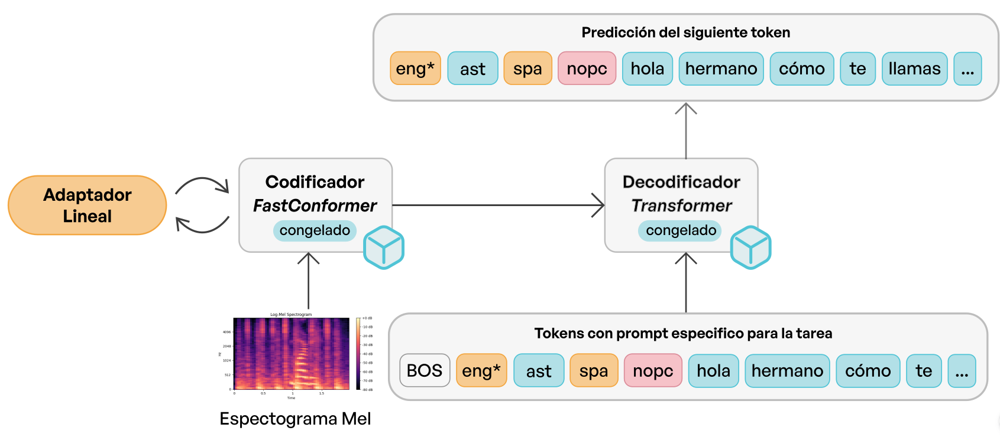
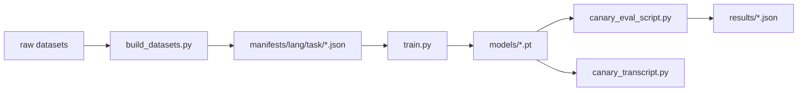

# IWSLT Experiments - Low Resource Track

[](README_ES.md)

This repository contains the experiments developed for participation in the [IWSLT 2026 shared task](https://iwslt.org/2026/low-resource), specifically in the low resource track. The objective is automatic speech translation (AST) and transcription (ASR) for low-resource languages, currently **Nahuatl (azz)**, **Mapudungun (arn/map)**, and **Quechua (que)**, with **AN4 (English)** as a control.

The [NVIDIA canary-1B-v2](https://huggingface.co/nvidia/canary-1b-v2) model is used as a base, applying PEFT techniques through linear adapters to adapt it to these languages with limited available data. For CPU prototyping we use `canary-1b-flash`.

## Architecture



## Pipeline



- `build_datasets.py`: downloads/extracts raw datasets (via the registry in `utils/configs.py`), processes them through the per-language processors in `data/processors.py`, and writes train/val/test manifests under `manifests/<language>/<task>/`.
- `train.py`: **main training script**. Loads the base Canary model, adds linear adapters to the encoder (and optionally the decoder), and trains with a Lightning trainer (bf16, gradient accumulation, DDP-aware). Adapters are saved with `model.save_adapters`.
- `data/`: `processors.py` (per-language manifest builders), `dataset.py` + `datamodule.py` (Lhotse-backed `CanaryMultilingualDataModule`).
- `utils/`: `configs.py` (paths, model IDs, split ratios, download registry), `downloader.py` / `extraction.py` (dataset acquisition), `logging_utils.py`.
- `canary_eval_script.py`: **main evaluation script**. WER, SacreBLEU, chrF2++ and BERTScore, reported **per task** when the manifest mixes `asr`/`ast`. Caches transcriptions to JSON so metrics can be recomputed without re-running inference.
- `canary_transcript.py`: generates the submission text files (`krusty_crab.st.constrained.*`).
- `custom_aumentation.py`: `audiomentations` pipeline (noise, pitch shift, band-pass, RIR) used in the data pipeline.
- `tests/`: pytest suite covering the downloader/extraction and the Mapudungun split logic.

Legacy/prototyping (superseded, kept for reference): `canary_script.py` (previous training script), `canary_experiments.py` and `notebooks/` (exploration notebooks), `process_manifets.py` (older manifest cleaner).

## Usage

### Environment

Python 3.12 with [uv](https://docs.astral.sh/uv/); all dependencies (including NeMo ASR) are declared in `pyproject.toml`:

```bash
uv sync --extra cu130   # GPU (CUDA 13.0); use --extra cpu for prototyping
```

`train.py` calls `huggingface_hub.login()`, so have an HF token available (`HF_TOKEN` or cached login).

### Dataset preparation

```bash
uv run python build_datasets.py --language-mode azz --task ast --download
uv run python build_datasets.py --language-mode map --task ast --max-examples 2000  # HF-only dataset, no download step
```

Manifests are written to `manifests/<language>/<task>/{train,val,test}_manifest.json`.

### Training

```bash
uv run python train.py --language-mode azz --task asr --batch-duration 60 --max-steps 1000
uv run python train.py --language-mode multi --task multitask --devices 2 --adapter-dec-dim 8
```

### GPU memory & batching decision

`train.py` batches training by **audio seconds** (`--batch-duration`, Lhotse `batch_duration` + `quadratic_duration`, following the Canary AED recipe) instead of a fixed number of utterances. `--batch-size` now only governs validation/test.

Why: with PEFT adapters, the frozen base saves optimizer/gradient state but **not activation memory**, which scales with the total seconds of audio per batch. A fixed `batch_size` caps the *number* of cuts, so a batch drawn from a 30-40 s bucket costs ~8x more memory than one from the 5 s bucket: nondeterministic OOMs on small GPUs as bucketing reaches long utterances, and wasted headroom on bigger ones. A duration budget gives a constant peak-memory profile across buckets and a single portable knob per machine (it applies per rank under DDP, so dual-GPU doubles the effective batch for free). Starting points, verify against the free-memory log `train.py` prints:

| Env | `--batch-duration` |
|---|---|
| 1x 12 GB (`canary-1b-flash`) | 45-60 |
| 1x 24 GB | 120-180 |
| 2x GPU (DDP) | same as single; effective batch x2 |

Validation/test keep a static `batch_size` with bucketing disabled (NeMo recipe convention: avoids rank-count imbalance during DDP validation). Their `max_duration` was raised from 15 s to 40 s to match training, so long utterances (e.g. Nahuatl Botanica AST segments) are no longer silently dropped from `val_wer`, the checkpoint/EarlyStopping monitor.

### Evaluation

```bash
uv run python canary_eval_script.py \
    --manifest manifests/azz/ast/test_manifest.json \
    --adapter-path models/canary_azz_asr_enc_32_dec_none_final.pt \
    --output-json results/run_01.json --baseline
```

With `--baseline` the vanilla model is evaluated first and results are saved as `*_baseline.json` / `*_adapted.json` pairs. Transcription caches (`*_predictions*.json`) let you rerun metrics on cached hypotheses.

### Submission transcription generation

```bash
uv run python canary_transcript.py --manifest path/test_manifest.json --adapter-path models/adapter_name.pt --label primary
```

## Reproducibility

Practices currently in place:

- **Pinned environment.** `pyproject.toml` + `uv.lock` pin every dependency, including the exact git commit of `nemo_toolkit[asr]`; `.python-version` fixes Python 3.12. The torch build (cpu vs cu130) is an explicit extra rather than an implicit resolution.
- **Data provenance.** Dataset sources (OpenSLR URLs, HF IDs) are declared in `DATASET_DOWNLOAD_REGISTRY` in `utils/configs.py` and fetched by `build_datasets.py --download`. Raw `datasets/`, generated `manifests/` and `models/` are gitignored — they are treated as regeneratable artifacts, not as source.
- **Seeded dataset construction.** The processors use a fixed seed (42) for splits and sampling, so the same raw data yields the same manifests.
- **Run artifacts.** Every training run writes a log file (`logs/*.log`), a TensorBoard directory, step-numbered checkpoints monitored on `val_wer` (plus `last.ckpt`, resumable via `trainer.fit(ckpt_path=...)`), and a final adapters bundle. `train.py` logs GPU memory and allocator settings at startup to make hardware context explicit.
- **Self-describing results.** Each `results/*.json` embeds the full run config (base model, adapter path, manifest, batch size, max samples, language pair, sample count), and the cached predictions file alongside it pins the exact hypotheses the metrics were computed from. Result JSONs are committed to the repo.
- **Metric definitions.** WER via NeMo, SacreBLEU with the `13a` tokenizer on the conventional 0-100 scale, chrF2++ (`char_order=6, word_order=2, beta=2`), BERTScore with `xlm-roberta-large`. Caveat: older results files store BLEU as 0-1 fractions (torchmetrics), i.e. these values divided by 100.
- **Tests.** `uv run pytest tests/` covers dataset download/extraction and the Mapudungun split logic.

Known gaps: `train.py` does not pin global torch/dataloader seeds, so training is not bitwise reproducible (esp. under bf16 + DDP); comparisons should average over `save_top_k` checkpoints or multiple seeds when precision matters.

---
**Base Model:** `nvidia/canary-1b-v2` (NVIDIA NeMo)

## Related notebook tutorial

- [Multi task Adapters tutorial](https://github.com/NVIDIA-NeMo/Speech/blob/main/tutorials/asr/asr_adapters/Multi_Task_Adapters.ipynb)
