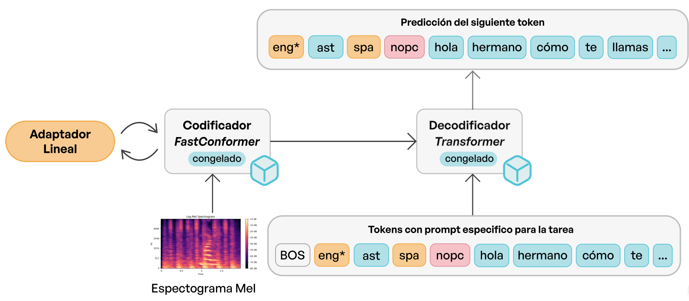
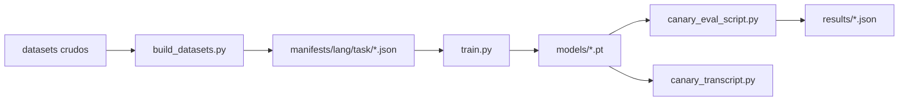

# Experimentos IWSLT - Low Resource Track

[](README.md)

Este repositorio contiene los experimentos desarrollados para participar en la shared task [IWSLT 2026](https://iwslt.org/2026/low-resource), específicamente en el track low resource. El objetivo es traducción automática de audio (AST) y transcripción (ASR) para lenguas de recursos bajos: actualmente **náhuatl (azz)**, **mapudungun (arn/map)** y **quechua (que)**, con **AN4 (inglés)** como control.

Se usa el modelo [NVIDIA canary-1B-v2](https://huggingface.co/nvidia/canary-1b-v2) como base, aplicando técnicas PEFT mediante linear adapters para adaptarlo a estas lenguas con datos limitados. Para prototipado en CPU usamos `canary-1b-flash`.

## Arquitectura



## Pipeline



- `build_datasets.py`: descarga/extrae los datasets crudos (vía el registry en `utils/configs.py`), los procesa con los processors por lengua en `data/processors.py` y escribe los manifests de train/val/test bajo `manifests/<language>/<task>/`.
- `train.py`: **script principal de entrenamiento**. Carga el modelo base Canary, agrega linear adapters al encoder (y opcionalmente al decoder), y entrena con un trainer de Lightning (bf16, gradient accumulation, DDP-aware). Los adapters se guardan con `model.save_adapters`.
- `data/`: `processors.py` (constructores de manifests por lengua), `dataset.py` + `datamodule.py` (`CanaryMultilingualDataModule` respaldado por Lhotse).
- `utils/`: `configs.py` (rutas, model IDs, proporciones de splits, download registry), `downloader.py` / `extraction.py` (adquisición de datasets), `logging_utils.py`.
- `canary_eval_script.py`: **script principal de evaluación**. WER, SacreBLEU, chrF2++ y BERTScore, reportados **por task** cuando el manifest mezcla `asr`/`ast`. Guarda en caché las transcripciones a JSON para poder recalcular métricas sin volver a correr la inferencia.
- `canary_transcript.py`: genera los archivos de texto para el envío a la shared task (`krusty_crab.st.constrained.*`).
- `custom_aumentation.py`: pipeline de `audiomentations` (ruido, pitch shift, band-pass, RIR) usado en la pipeline de datos.
- `tests/`: suite de pytest que cubre el downloader/extraction y la lógica de splits de Mapudungun.

Legado/prototipado (superados, se mantienen como referencia): `canary_script.py` (script de entrenamiento anterior), `canary_experiments.py` y `notebooks/` (notebooks de exploración), `process_manifets.py` (limpiador de manifests más antiguo).

## Uso

### Entorno

Python 3.12 con [uv](https://docs.astral.sh/uv/); todas las dependencias (incluida NeMo ASR) están declaradas en `pyproject.toml`:

```bash
uv sync --extra cu130   # GPU (CUDA 13.0); usar --extra cpu para prototipado
```

`train.py` llama a `huggingface_hub.login()`, así que ten disponible un token de HF (`HF_TOKEN` o login cacheado).

### Preparación de datasets

```bash
uv run python build_datasets.py --language-mode azz --task ast --download
uv run python build_datasets.py --language-mode map --task ast --max-examples 2000  # dataset solo de HF, sin paso de descarga
```

Los manifests se escriben en `manifests/<language>/<task>/{train,val,test}_manifest.json`.

### Entrenamiento

```bash
uv run python train.py --language-mode azz --task asr --batch-duration 60 --max-steps 1000
uv run python train.py --language-mode multi --task multitask --devices 2 --adapter-dec-dim 8
```

### Memoria de GPU y decisión de batching

`train.py` agrupa el entrenamiento por **segundos de audio** (`--batch-duration`, Lhotse `batch_duration` + `quadratic_duration`, siguiendo la receta de Canary AED) en lugar de un número fijo de utterances. `--batch-size` ahora solo rige validación/test.

Por qué: con PEFT adapters, la base congelada ahorra el estado de optimizadores/gradients pero **no la memoria de activaciones**, que escala con los segundos totales de audio por batch. Un `batch_size` fijo limita el *número* de cuts, así que un batch del bucket de 30-40 s cuesta ~8x más memoria que uno del bucket de 5 s: OOMs no deterministas en GPUs pequeñas cuando el bucketing llega a utterances largas, y capacidad desperdiciada en GPUs grandes. Un presupuesto de duración da un perfil de memoria pico constante entre buckets y un único knob portable por máquina (se aplica por rank bajo DDP, así que dual-GPU duplica el batch efectivo gratis). Puntos de partida, verificar contra el log de memoria libre que imprime `train.py`:

| Entorno | `--batch-duration` |
|---|---|
| 1x 12 GB (`canary-1b-flash`) | 45-60 |
| 1x 24 GB | 120-180 |
| 2x GPU (DDP) | igual que una sola; batch efectivo x2 |

Validación/test mantienen un `batch_size` estático con bucketing deshabilitado (convención de la receta de NeMo: evita desbalance en el conteo de ranks durante la validación DDP). Su `max_duration` se subió de 15 s a 40 s para igualar al entrenamiento, de modo que las utterances largas (p. ej. segmentos AST de Nahuatl Botanica) ya no se descartan silenciosamente de `val_wer`, el monitor de checkpoint/EarlyStopping.

### Evaluación

```bash
uv run python canary_eval_script.py \
    --manifest manifests/azz/ast/test_manifest.json \
    --adapter-path models/canary_azz_asr_enc_32_dec_none_final.pt \
    --output-json results/run_01.json --baseline
```

Con `--baseline` se evalúa primero el modelo vanilla y los resultados se guardan como pares `*_baseline.json` / `*_adapted.json`. Las cachés de transcripciones (`*_predictions*.json`) permiten volver a calcular métricas sobre las hipótesis cacheadas.

### Generación de transcripciones para el envío

```bash
uv run python canary_transcript.py --manifest path/test_manifest.json --adapter-path models/adapter_name.pt --label primary
```

## Reproducibilidad

Prácticas actualmente implementadas:

- **Entorno pinneado.** `pyproject.toml` + `uv.lock` fijan cada dependencia, incluido el commit git exacto de `nemo_toolkit[asr]`; `.python-version` fija Python 3.12. El build de torch (cpu vs cu130) es un extra explícito en lugar de una resolución implícita.
- **Procedencia de datos.** Las fuentes de los datasets (URLs de OpenSLR, IDs de HF) están declaradas en `DATASET_DOWNLOAD_REGISTRY` en `utils/configs.py` y se descargan con `build_datasets.py --download`. Los `datasets/` crudos, los `manifests/` generados y `models/` están en gitignore — se tratan como artefactos regenerables, no como fuente.
- **Construcción de datasets con seed.** Los processors usan una seed fija (42) para splits y sampling, así que los mismos datos crudos producen los mismos manifests.
- **Artefactos de cada run.** Cada entrenamiento escribe un log (`logs/*.log`), un directorio de TensorBoard, checkpoints numerados por step monitoreados en `val_wer` (más `last.ckpt`, reanudable vía `trainer.fit(ckpt_path=...)`), y un bundle final de adapters. `train.py` registra la memoria de GPU y la configuración del allocator al iniciar, para hacer explícito el contexto de hardware.
- **Resultados auto-descriptivos.** Cada `results/*.json` incluye el config completo del run (modelo base, adapter path, manifest, batch size, max samples, par de lenguas, cantidad de muestras), y el archivo de prediccions cacheadas junto a él fija exactamente las hipótesis sobre las que se calcularon las métricas. Los JSON de resultados se comitean al repo.
- **Definición de métricas.** WER vía NeMo, SacreBLEU con tokenizer `13a` en la escala convencional 0-100, chrF2++ (`char_order=6, word_order=2, beta=2`), BERTScore con `xlm-roberta-large`. Advertencia: archivos de resultados antiguos guardan BLEU como fracciones 0-1 (torchmetrics), es decir estos valores divididos por 100.
- **Tests.** `uv run pytest tests/` cubre la descarga/extracción de datasets y la lógica de splits de Mapudungun.

Brechas conocidas: `train.py` no fija seeds globales de torch/dataloader, así que el entrenamiento no es reproducible bit a bit (especialmente bajo bf16 + DDP); cuando la precisión importe, las comparaciones deberían promediar sobre los checkpoints de `save_top_k` o sobre múltiples seeds.

---
**Modelo base:** `nvidia/canary-1b-v2` (NVIDIA NeMo)

## Tutorial de notebook relacionado

- [Multi task Adapters tutorial](https://github.com/NVIDIA-NeMo/Speech/blob/main/tutorials/asr/asr_adapters/Multi_Task_Adapters.ipynb)
